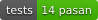
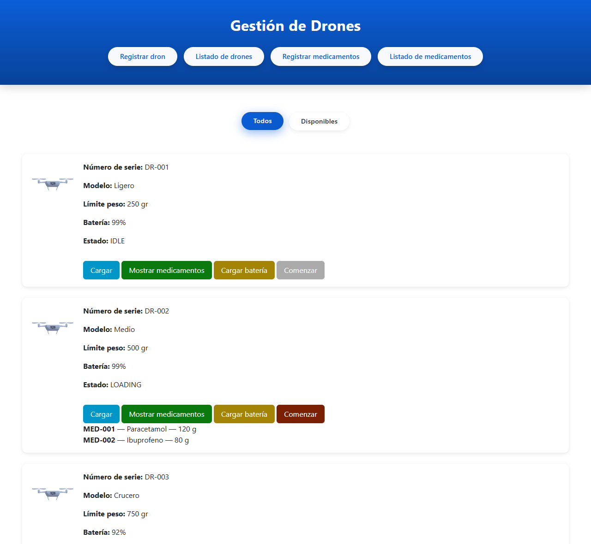
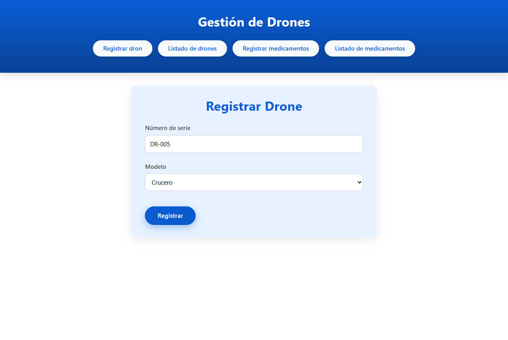
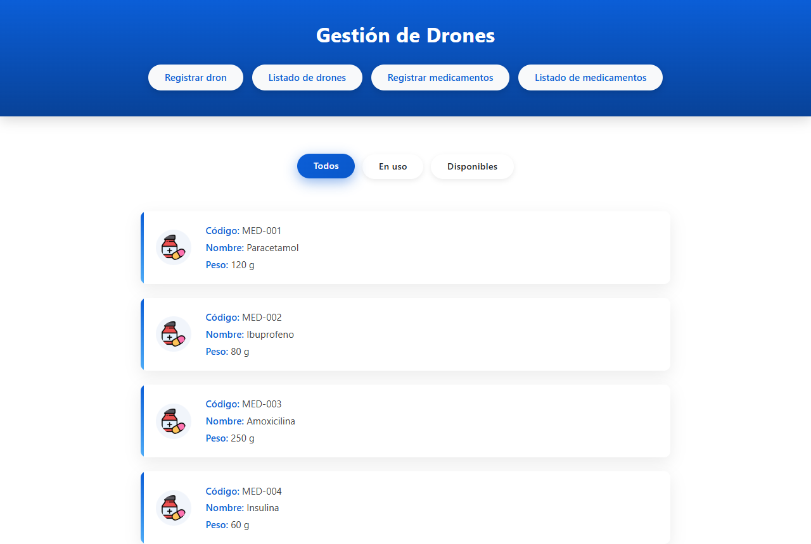
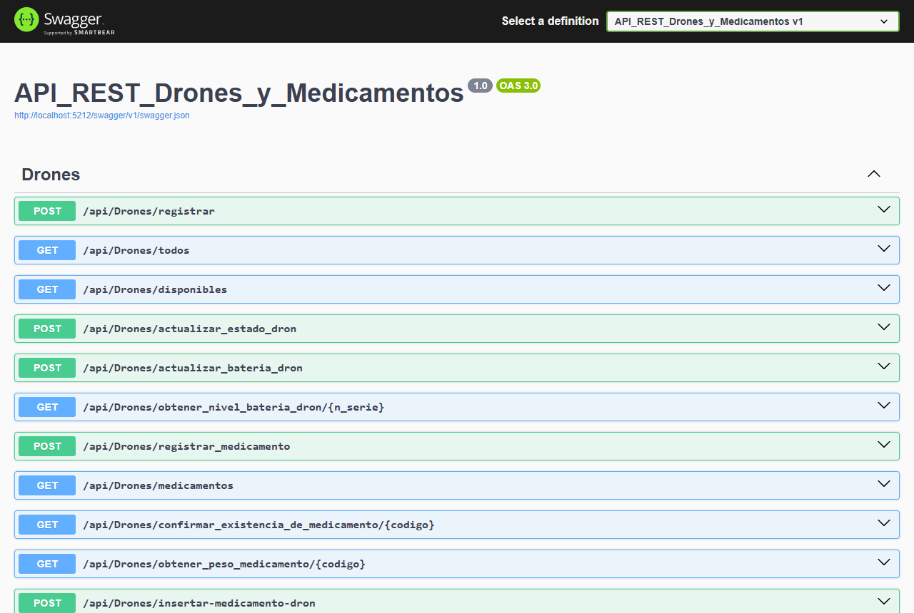

<h1 align="center">🚁 Drones y Medicamentos</h1>

<p align="center">
  
  
  
  
  
</p>

**Drones y Medicamentos** es una aplicación web para gestionar una flota de drones que reparten medicamentos. Puedes registrar drones y medicamentos, cargar cada dron sin pasarte de su límite de peso, controlar su batería y lanzar la entrega: el dron pasa por todos los estados (cargado, repartiendo, entregado, volviendo) y al regresar queda vacío y listo para otro viaje. Por dentro es una **API REST en ASP.NET 8 (C#)** con base de datos **SQLite** y una web en **HTML, CSS y JavaScript**.

<p align="center">
  
</p>

---

## Instalación

### Windows: sin instalar nada

<p align="center">
  <a href="https://github.com/walteralee/Drones-y-Medicamentos-ASP.NET/releases/latest/download/DronesYMedicamentos-Windows.zip">
    
  </a>
</p>

1. **Descarga** el ZIP con el botón de arriba.
2. **Descomprímelo** (clic derecho > *Extraer todo*).
3. **Haz doble clic** en `DronesYMedicamentos.exe`. Se abre el navegador con la aplicación.

> No necesitas instalar .NET ni nada más: todo va dentro. Para cerrarla, cierra la ventana negra.
> Si Windows muestra *"Windows protegió su PC"*, pulsa **Más información > Ejecutar de todas formas** (sale porque el programa no está firmado).
> Para desinstalarlo, borra la carpeta.

### Mac y Linux (o Windows con Docker)

Con [Docker Desktop](https://www.docker.com/products/docker-desktop/) abierto, ejecuta en una terminal:

```bash
git clone https://github.com/walteralee/Drones-y-Medicamentos-ASP.NET.git
```

```bash
cd Drones-y-Medicamentos-ASP.NET
```

```bash
docker compose up -d
```

Abre **http://localhost:5212** en el navegador. Para apagarla: `docker compose down`.

> Los datos se guardan en un volumen de Docker y se mantienen aunque la apagues.

---

## Funcionalidades

- **Registrar drones** de 4 modelos, cada uno con su límite de peso: Ligero (250 g), Medio (500 g), Crucero (750 g) y Pesado (1000 g).
- **Registrar medicamentos** con código, nombre y peso (de 1 a 1000 g).
- **Cargar medicamentos en un dron.** La aplicación no te deja:
  - pasarte del límite de peso del dron,
  - cargar un dron con un 25 % de batería o menos,
  - cargar un dron que está repartiendo,
  - poner el mismo medicamento en dos drones.
- **Entregas:** al pulsar *Comenzar*, el dron pasa por `LOADED → DELIVERING → DELIVERED → RETURNING → IDLE`, gasta batería en cada paso y al volver se vacía.
- **Batería:** baja con el uso y con el tiempo; se recarga al 100 % con un botón.
- **Filtros:** drones disponibles (en IDLE y con más del 25 % de batería) y medicamentos en uso o libres.
- **Swagger** en `/swagger` para probar la API desde el navegador.

<p align="center">
  
  &nbsp;
  
</p>

## Tecnologías

| | |
|---|---|
| Backend | C# · ASP.NET 8 (API REST con controladores) |
| Base de datos | SQLite (se crea sola al arrancar) con Microsoft.Data.Sqlite |
| Frontend | HTML, CSS, JavaScript y Bootstrap 5 |
| Documentación de la API | Swagger (Swashbuckle) |
| Tests | xUnit + WebApplicationFactory (14 tests de integración) |
| Despliegue | Ejecutable de Windows autocontenido y Docker |

## API

Todas las rutas empiezan por `/api/drones`. Puedes probarlas en **http://localhost:5212/swagger**.

| Método | Ruta | Qué hace |
|---|---|---|
| POST | `/registrar` | Registra un dron (`serialNumber`, `model`) |
| GET | `/todos` | Lista todos los drones |
| GET | `/disponibles` | Drones en IDLE con más del 25 % de batería |
| POST | `/actualizar_estado_dron?numero_serie=&estado=` | Cambia el estado de un dron |
| POST | `/actualizar_bateria_dron?numero_serie=&proceso=cargar\|reducir` | Recarga al 100 % o baja un 1 % |
| GET | `/obtener_nivel_bateria_dron/{n_serie}` | Batería de un dron |
| POST | `/registrar_medicamento` | Registra un medicamento (`codigo`, `nombre`, `peso`) |
| GET | `/medicamentos?estado=all\|in-use\|available` | Lista medicamentos con filtro |
| GET | `/confirmar_existencia_de_medicamento/{codigo}` | `true` o `false` |
| GET | `/obtener_peso_medicamento/{codigo}` | Peso de un medicamento |
| POST | `/insertar-medicamento-dron` | Carga un medicamento en un dron (`numero_serie`, `codigo`) |
| GET | `/mostrar_medicamentos_de_dron/{numero_serie}` | Medicamentos que lleva un dron |
| DELETE | `/eliminar_relaciones_y_medicamentos/{numero_serie}` | Vacía el dron al terminar la entrega |

<p align="center">
  
</p>

## Ejecutar desde el código

Solo si quieres ver o modificar el código. Necesitas el [SDK de .NET 8](https://dotnet.microsoft.com/download/dotnet/8.0) (o superior).

- **Windows:** doble clic en **`run.bat`**.
- **Mac / Linux:** `./run.sh`

Compila, arranca y abre el navegador en **http://localhost:5212** con la web y la API juntas. También puedes abrir `DronesYMedicamentos.sln` con Visual Studio o Rider y pulsar ▶.

**Tests** (desde la raíz):

```bash
dotnet test
```

**Generar el ZIP de Windows** (desde la raíz, queda en `dist/`):

```bash
powershell -ExecutionPolicy Bypass -File scripts/publicar-windows.ps1
```

## Arquitectura

El backend es una API REST **por capas**: cada capa solo habla con la de debajo.

```text
Petición HTTP
   │
   ▼
Controladores   reciben la petición y responden (sin reglas)
   │
   ▼
Servicios       reglas de negocio: modelos, estados, batería, límite de peso
   │
   ▼
Repositorios    consultas SQL a SQLite (detrás de una interfaz)
   │
   ▼
Datos           conexión y creación de la base de datos
```

Los errores de negocio se lanzan como excepciones (`ErrorDeNegocio` → 400, `NoEncontrado` → 404) y un único `ManejadorErrores` los convierte en JSON `{ "message": "..." }`. El frontend sigue la misma idea: `api.js` solo hace peticiones y `app.js` solo maneja la pantalla.

## Estructura

```text
DronesYMedicamentos.sln     solución (.NET)
run.bat · run.sh            arrancar desde el código
backend/                    API REST en ASP.NET 8
├── Controladores/          DronesController: endpoints HTTP
├── Servicios/              DronServicio y MedicamentoServicio: reglas de negocio
├── Repositorios/           acceso a SQLite (interfaces + implementación)
├── Datos/                  conexión y creación de la base de datos
├── Modelos/                Drone, Medicamento, CargaMedicamento y ReglasDron
├── Errores/                errores de negocio y manejador global
└── Program.cs              arranque: capas, Swagger, web y navegador
frontend/                   web
├── index.html
├── css/estilos.css
├── js/api.js               peticiones a la API
├── js/app.js               interfaz
└── imagenes/
tests/                      tests de integración de la API (xUnit)
scripts/                    publicar-windows.ps1: genera el ZIP de Windows
datos/                      base de datos SQLite (se crea sola, no se sube a Git)
Dockerfile · docker-compose.yml
```

## Autor

**Walter Alejandro Cutiño Ledo** · [github.com/walteralee](https://github.com/walteralee)

---

## English

**Drones y Medicamentos** is a web app to manage a fleet of delivery drones that carry medicines: register drones and medicines, load each drone without exceeding its weight limit, track its battery and run the delivery cycle (`LOADED → DELIVERING → DELIVERED → RETURNING → IDLE`). Built with an **ASP.NET 8 REST API (C#)**, **SQLite** and an **HTML/CSS/JavaScript** frontend, with 14 integration tests.

**Install:**

- **Windows (nothing to install):** download **[DronesYMedicamentos-Windows.zip](https://github.com/walteralee/Drones-y-Medicamentos-ASP.NET/releases/latest/download/DronesYMedicamentos-Windows.zip)**, unzip it and double-click `DronesYMedicamentos.exe`. The browser opens by itself.
- **Mac / Linux (Docker):** `git clone` the repo, then run `docker compose up -d` and open http://localhost:5212.

**From source:** run `run.bat` (Windows) or `./run.sh` (Mac/Linux) with the .NET 8 SDK. Layered architecture: controllers → services → repositories → SQLite. API docs at `/swagger`.
**Author:** Walter Alejandro Cutiño Ledo · [github.com/walteralee](https://github.com/walteralee)
